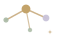

  

  

# Hafiar

Bug hunter, pentester, and OSINT investigator. I reproduce published vulnerabilities, run authorized engagements, and build the tools I would otherwise write by hand.

  

##  Research

| Advisory | What it is | Score |
|---|---|---|
| [CVE-2026-41089](https://github.com/0xABCD01/CVE-2026-41089) | Netlogon CLDAP stack buffer overflow. One unauthenticated UDP packet to a domain controller. | CVSS 9.8, CWE-121 |
| [CVE-2026-48866](https://github.com/0xABCD01/CVE-2026-48866) | Gravity Forms path traversal into arbitrary file deletion. | CVSS 9.6, CWE-22 |
| [SA-CORE-2026-014](https://github.com/0xABCD01/drupal-11.4.9-vuln-lab) | Drupal `field_ui` render-array callback. RCE once a contributed module is in play. | Drupal 11.4.9, fixed in 11.4.10 |

The [Drupal lab](https://github.com/0xABCD01/drupal-11.4.9-vuln-lab) covers all three core advisories that 11.4.9 shipped with, including the two stored XSS issues. Every proof of concept runs against a local container, never a third-party host.

##  Tools

| Repository | What it does |
|---|---|
| [test-amnesty](https://github.com/0xABCD01/test-amnesty) | Compares an edited pytest file against the original and catches tests that were weakened to pass. |
| [cachelint](https://github.com/0xABCD01/cachelint) | Predicts which Dockerfile layer busts the build cache and suggests a faster order. |
| [codex-skills](https://github.com/0xABCD01/codex-skills) | Workflow prompts for Codex CLI. Each one pins exact commands so the model cannot skip a step. |
| [cloud-file-manager](https://github.com/0xABCD01/cloud-file-manager) | Self-hosted file manager with encryption at rest, per-file permissions, and access logs. |
| [crystal-cavern](https://github.com/0xABCD01/crystal-cavern) | Puzzle game written in C++17 and compiled to WebAssembly, no runtime dependencies. [Play it](https://0xabcd01.github.io/crystal-cavern/). |

##  Currently

- Building reproductions for Drupal 11.4.x advisories, one repository per release.
- Turning the parts of pentesting I repeat by hand into small tools.

##  Contact

- X: [@VortexXzy](https://x.com/VortexXzy)
- Bug reports and questions: open an issue on the relevant repository.

  

