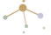
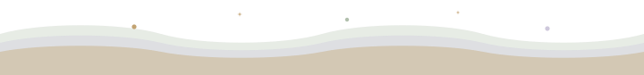

  

  

# Hafiar

Bug hunter, pentester, and OSINT investigator. I reproduce published vulnerabilities, run authorized engagements, and build the tools I would otherwise write by hand. I also audit open-source libraries and send the fixes upstream.

  

  

  

##  Research

| Advisory | What it is | Score |
|---|---|---|
| [CVE-2026-41089](https://github.com/0xABCD01/CVE-2026-41089) | Netlogon CLDAP stack buffer overflow. One unauthenticated UDP packet to a domain controller. | CVSS 9.8, CWE-121 |
| [CVE-2026-48866](https://github.com/0xABCD01/CVE-2026-48866) | Gravity Forms path traversal into arbitrary file deletion. | CVSS 9.6, CWE-22 |
| [SA-CORE-2026-014](https://github.com/0xABCD01/drupal-11.4.9-vuln-lab) | Drupal `field_ui` render-array callback. RCE once a contributed module is in play. | Drupal 11.4.9, fixed in 11.4.10 |

The [Drupal lab](https://github.com/0xABCD01/drupal-11.4.9-vuln-lab) covers all three core advisories that 11.4.9 shipped with, including the two stored XSS issues. Every proof of concept runs against a local container, never a third-party host.

##  Open source

| Project | Contribution | Status |
|---|---|---|
| symfony/symfony | [Strip the byte order mark at the start of a YAML stream](https://github.com/symfony/symfony/pull/67735) | Merged |
| symfony/symfony | [Skip empty lines when decoding CSV in the Serializer](https://github.com/symfony/symfony/pull/67752) | Merged |
| symfony/symfony | [Fix Glob patterns whose bracket expression contains a slash](https://github.com/symfony/symfony/pull/67785) | Merged |
| projectdiscovery/dsl | [Return errors instead of panicking on negative repeat counts and substr starts](https://github.com/projectdiscovery/dsl/pull/368) | Merged |
| projectdiscovery/nuclei | [Bump govaluate and antchfx/xpath past two template panics](https://github.com/projectdiscovery/nuclei/pull/7998) | Merged |
| projectdiscovery/nuclei | [Add a regression test for the govaluate string concatenation bug](https://github.com/projectdiscovery/nuclei/pull/8013) | Merged |
| symfony/ux | [Let LiveComponent collections contain null items during (de)hydration](https://github.com/symfony/ux/pull/4194) | Merged |
| WordPress/sqlite-database-integration | [Quote SQLite identifiers in LOCK TABLES, SHOW TABLES, and compound-PK indexes](https://github.com/WordPress/sqlite-database-integration/pull/599) | Merged |
| WordPress/sqlite-database-integration | [Split MySQL Proxy result packets at the maximum packet length](https://github.com/WordPress/sqlite-database-integration/pull/601) | Open |
| WordPress/sqlite-database-integration | [Pass workflow values via env in release workflows](https://github.com/WordPress/sqlite-database-integration/pull/604) | Open |
| pypi/warehouse | [Fix footer color contrast and landmark coverage](https://github.com/pypi/warehouse/pull/20882) | Open |
| pypi/warehouse | [Make search-button focus visible and stop the classifier filter trapping keyboard focus](https://github.com/pypi/warehouse/pull/20884) | Open |
| pypi/inspector | [Normalize archive member names so bad directory entries are browsable](https://github.com/pypi/inspector/pull/336) | Open |
| Panniantong/agent-reach | [Treat an all-NOT_FOUND live test as a stale sample, not a broken channel](https://github.com/Panniantong/agent-reach/pull/909) | Open |
| huggingface/transformers | [Fix CLAP loss double-counting the text-to-audio direction](https://github.com/huggingface/transformers/pull/50319) | Open |
| dwisiswant0/apkleaks | [Stop the IP address pattern truncating the last octet](https://github.com/dwisiswant0/apkleaks/pull/107) | Open |
| dwisiswant0/apkleaks | [Stop the CTF flag pattern matching plain CSS rules](https://github.com/dwisiswant0/apkleaks/pull/108) | Open |
| thedotmack/claude-mem | [Keep the doc_type filter out of the semantic search fallback query](https://github.com/thedotmack/claude-mem/pull/5355) | Merged |
| thedotmack/claude-mem | [Park queued messages at the process hard cap instead of discarding them](https://github.com/thedotmack/claude-mem/pull/5388) | Merged |
| openai/codex-security | [Recheck empty targets before a resumed scan's first dispatch](https://github.com/openai/codex-security/pull/2346) | Merged |
| anthropics/claude-quickstarts | [Continue paused server-tool turns instead of returning them unfinished](https://github.com/anthropics/claude-quickstarts/pull/533) | Open |
| anomalyco/opencode | [Do not reuse an unmigrated V1 session ID on create](https://github.com/anomalyco/opencode/pull/62014) | Open |
| thedotmack/claude-mem | [Persist SessionStart toggles and accept zero context counts via POST /api/settings](https://github.com/thedotmack/claude-mem/pull/5393) | Merged |
| thedotmack/claude-mem | [Discard a stalled session's buffered work once its resumes are spent](https://github.com/thedotmack/claude-mem/pull/5414) | Merged |
| thedotmack/claude-mem | [Keep context reads working when the WAL index cannot be established](https://github.com/thedotmack/claude-mem/pull/5432) | Merged |
| thedotmack/claude-mem | [Run the My Work refresh on the configured provider's agent first](https://github.com/thedotmack/claude-mem/pull/5436) | Merged |
| apache/httpd | [Bind mod_authn_socache cache keys to the authentication domain](https://github.com/apache/httpd/pull/930) | Open |
| ClickHouse/ClickHouse | [Make equal ClickHouseVersion objects hash equal so set and dict lookups dedupe them](https://github.com/ClickHouse/ClickHouse/pull/129594) | Open |
| ClickHouse/ClickHouse | [Honor glob excludes and not_exists_ok in praktika path traversal for job digests](https://github.com/ClickHouse/ClickHouse/pull/129595) | Open |
| caddyserver/caddy | [Reject Caddyfile site blocks with unbalanced braces](https://github.com/caddyserver/caddy/pull/8375) | Merged |
| thedotmack/claude-mem | [Ship better-auth in the plugin install and create its auth tables](https://github.com/thedotmack/claude-mem/pull/5455) | Merged |
| micropython/micropython | [Support converting int subclass instances to float](https://github.com/micropython/micropython/pull/19904) | Open |
| charmbracelet/x | [Stop the ANSI decoder panicking on sequences with more than 32 parameters](https://github.com/charmbracelet/x/pull/1040) | Open |
| composer/composer | [Use recorded install paths when building the plugin runtime autoloader](https://github.com/composer/composer/pull/13250) | Open |
| sherlock-project/sherlock | [Stop usernames escaping the output folder in result filenames](https://github.com/sherlock-project/sherlock/pull/3211) | Open |
| google/go-containerregistry | [Write cached layers via a temporary file so concurrent readers never see a partial layer](https://github.com/google/go-containerregistry/pull/2505) | Open |

  
  

  

  <picture>
    <source media="(prefers-color-scheme: dark)" srcset="https://raw.githubusercontent.com/0xABCD01/0xABCD01/output/github-contribution-grid-snake-dark.svg">
    <source media="(prefers-color-scheme: light)" srcset="https://raw.githubusercontent.com/0xABCD01/0xABCD01/output/github-contribution-grid-snake.svg">
    
  </picture>

##  Tools

| Repository | What it does |
|---|---|
| [test-amnesty](https://github.com/0xABCD01/test-amnesty) | Compares an edited pytest file against the original and catches tests that were weakened to pass. |
| [cachelint](https://github.com/0xABCD01/cachelint) | Predicts which Dockerfile layer busts the build cache and suggests a faster order. |
| [codex-skills](https://github.com/0xABCD01/codex-skills) | Workflow prompts for Codex CLI. Each one pins exact commands so the model cannot skip a step. |
| [cloud-file-manager](https://github.com/0xABCD01/cloud-file-manager) | Self-hosted file manager with encryption at rest, per-file permissions, and access logs. |
| [crystal-cavern](https://github.com/0xABCD01/crystal-cavern) | Puzzle game written in C++17 and compiled to WebAssembly, no runtime dependencies. [Play it](https://0xabcd01.github.io/crystal-cavern/). |

  

##  Currently

- Building reproductions for Drupal 11.4.x advisories, one repository per release.
- Auditing fresh open-source releases. Five reports are sitting with vendors and maintainers right now.
- Turning the parts of pentesting I repeat by hand into small tools.

  

##  Contact

- X: [@VortexXzy](https://x.com/VortexXzy)
- Bug reports and questions: open an issue on the relevant repository.

  

  

