<p align="center">
  
</p>

# Hafiar

Bug hunter, pentester, and OSINT investigator. I reproduce published vulnerabilities, run authorized engagements, and build the tools I would otherwise write by hand.

## Research

| Advisory | What it is | Score |
|---|---|---|
| [CVE-2026-41089](https://github.com/0xABCD01/CVE-2026-41089) | Netlogon CLDAP stack buffer overflow. One unauthenticated UDP packet to a domain controller. | CVSS 9.8, CWE-121 |
| [CVE-2026-48866](https://github.com/0xABCD01/CVE-2026-48866) | Gravity Forms path traversal into arbitrary file deletion. | CVSS 9.6, CWE-22 |
| [SA-CORE-2026-014](https://github.com/0xABCD01/drupal-11.4.9-vuln-lab) | Drupal `field_ui` render-array callback. RCE once a contributed module is in play. | Drupal 11.4.9, fixed in 11.4.10 |

The [Drupal lab](https://github.com/0xABCD01/drupal-11.4.9-vuln-lab) covers all three core advisories that 11.4.9 shipped with, including the two stored XSS issues. Every proof of concept runs against a local container, never a third-party host.

## Tools

| Repository | What it does |
|---|---|
| [test-amnesty](https://github.com/0xABCD01/test-amnesty) | Compares an edited pytest file against the original and catches tests that were weakened to pass. |
| [cachelint](https://github.com/0xABCD01/cachelint) | Predicts which Dockerfile layer busts the build cache and suggests a faster order. Published on PyPI. |
| [codex-skills](https://github.com/0xABCD01/codex-skills) | Workflow prompts for Codex CLI. Each one pins exact commands so the model cannot skip a step. |
| [cloud-file-manager](https://github.com/0xABCD01/cloud-file-manager) | Self-hosted file manager with encryption at rest, per-file permissions, and access logs. |
| [crystal-cavern](https://github.com/0xABCD01/crystal-cavern) | Puzzle game written in C++17 and compiled to WebAssembly, no runtime dependencies. [Play it](https://0xabcd01.github.io/crystal-cavern/). |

## Writing standards

Security work gets read by humans, so the prose has to survive next to the proof of concept. I run my own writing through these three before it ships.

[](https://skills.sh/hardikpandya/stop-slop)
[](https://skills.sh/petergyang/no-ai-slop/no-ai-slop)
[](https://skills.sh/blader/humanizer)

```sh
npx skills add hardikpandya/stop-slop
npx skills add https://github.com/petergyang/no-ai-slop --skill no-ai-slop
npx skills add blader/humanizer
```

`stop-slop` strips filler and flattens formulaic rhythm. `no-ai-slop` edits a draft against twenty named patterns without sanding off the original voice. `humanizer` works from the Wikipedia list of AI tells and runs a draft, audit, and rewrite loop. All three are MIT.

The same discipline drives [codex-skills](https://github.com/0xABCD01/codex-skills). A prompt that names the steps stops the model from improvising around them.

## Currently

- Building reproductions for Drupal 11.4.x advisories, one repository per release.
- Turning the parts of pentesting I repeat by hand into small tools.

## Contact

- X: [@VortexXzy](https://x.com/VortexXzy)
- Bug reports and questions: open an issue on the relevant repository.
